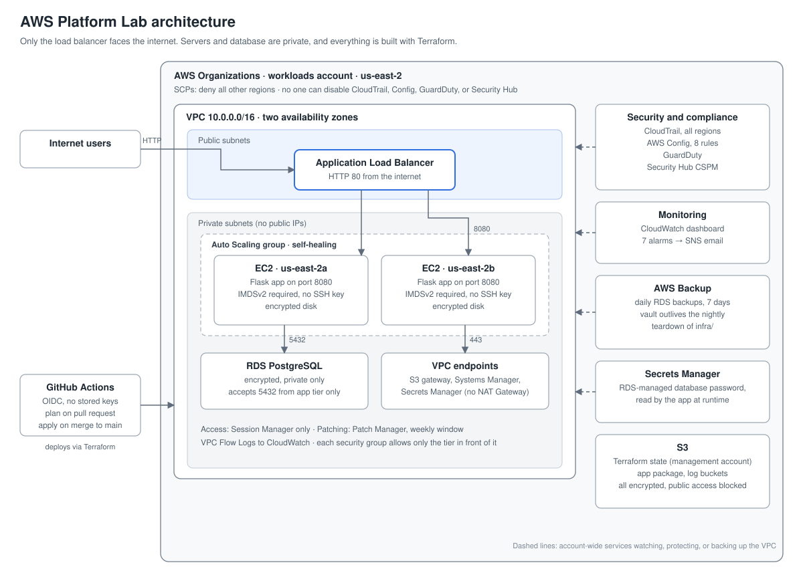

# AWS Platform Lab

A production-style AWS environment built entirely with Terraform: a multi-AZ VPC, a load-balanced and self-healing app tier, an encrypted RDS database, a keyless CI/CD pipeline, and a layered set of security, monitoring, and backup controls.

The app is deliberately tiny (a Flask page that counts visits). The point of the project is the **platform**: how the app is provisioned, secured, monitored, recovered, and paid for.

> This is a hands-on lab project, built and tested over one week. It is not a production system, but every component was deployed, broken on purpose, and verified.

## What it demonstrates

| Area | What was built |
| --- | --- |
| **Platform administration** | Compute, storage, networking, and identity resources in Terraform; Patch Manager; AWS Backup with a verified restore |
| **Cloud engineering** | Infrastructure as code across five Terraform configurations; Auto Scaling and load balancing; GitHub Actions pipeline |
| **Security and governance** | AWS Organizations with SCPs; least-privilege IAM; GitHub OIDC (no stored keys); CloudTrail, AWS Config, GuardDuty, Security Hub; account-level hardening |
| **Monitoring and incident response** | CloudWatch dashboard and 7 alarms with email alerts; staged outages with a written incident report |
| **Cost management** | Nightly teardown, NAT-free networking, cost allocation tags, and a cost breakdown by service |

## Architecture

[](docs/architecture.svg)

*Click the diagram to open it full size. A PNG copy is in [`docs/architecture.png`](docs/architecture.png).*

Only the load balancer is reachable from the internet. Each security group accepts traffic only from the tier in front of it, outbound traffic is restricted too, and servers are managed through Systems Manager Session Manager rather than SSH.

## Repository layout

| Folder | Purpose | Lifecycle |
| --- | --- | --- |
| `bootstrap/` | S3 bucket for Terraform state (versioned, encrypted, public access blocked) | Permanent |
| `org/` | AWS Organization, Workloads OU and account, service control policies | Permanent |
| `iam/` | GitHub OIDC provider; read-only plan role and main-branch-only apply role | Permanent |
| `security/` | CloudTrail, Config, GuardDuty, Security Hub, account hardening, SNS alerts, AWS Backup | Permanent for the lab |
| `infra/` | VPC, endpoints, security groups, load balancer, Auto Scaling, RDS, patching, monitoring | **Destroyed nightly** |
| `app/` | Flask app and a build script that bundles its dependencies | Built on each deploy |
| `.github/workflows/` | Terraform pipeline for `infra/` and `app/` | |
| `docs/` | Runbooks, incident report, and cost breakdown | |

Backups live in `security/`, not `infra/`, so they survive the nightly teardown of the database they protect.

## How to deploy

Prerequisites: Terraform 1.10 or later, the AWS CLI with the Session Manager plugin, Python 3 with pip (for `app/build.sh`), a GitHub repository, and an AWS account to use as the Organization's management account.

To deploy in your own account, first replace the values specific to this one: the state bucket name in every `backend "s3"` block, the workloads account ID in `iam/`, `infra/`, `security/`, and the workflow file, and the GitHub owner, repo, and numeric IDs in `iam/main.tf`.

Apply the folders in order, from the management account's credentials:

```bash
cd bootstrap && terraform init && terraform apply   # state bucket
cd ../org    && terraform init && terraform apply   # Organization, account, SCPs
cd ../iam    && terraform init && terraform apply   # GitHub OIDC roles
cd ../security
echo 'alert_email = "you@example.com"' > terraform.tfvars   # not committed
terraform init && terraform apply                  # security, alerts, backup
cd ../app    && ./build.sh                          # bundle the app
cd ../infra  && terraform init && terraform apply   # the environment (~25 min)
```

After the first build, changes to `infra/` and `app/` go through pull requests: the pipeline runs `terraform plan` with the read-only role and comments the result, and merging to `main` runs `terraform apply` with the apply role.

## Daily operations

- **Teardown:** `cd infra && terraform destroy` at the end of each day. Everything billable by the hour lives here.
- **Rebuild:** `terraform apply` the next morning, or merge a change and let the pipeline build it.
- **Access a server:** `aws ssm start-session --target <instance-id>`. There are no SSH keys.
- **Runbooks:** [Security finding](docs/runbooks/security-finding.md) · [App 5xx or unhealthy-host alarm](docs/runbooks/app-5xx-alarm.md)

## What was tested

| Test | Result |
| --- | --- |
| SCP region guardrail | Actions outside us-east-2 denied, even for administrators |
| SCP protecting security services | An admin role's attempt to stop CloudTrail logging was denied |
| Pipeline with GitHub OIDC | Pull requests planned with the read-only role; only merges to `main` applied, with the apply role; no AWS keys stored in GitHub |
| AWS Config violation | Removed a bucket's public access block; flagged NON_COMPLIANT within minutes, fixed, returned to COMPLIANT; CloudTrail identified the change |
| Self-healing, one server | Failed server detected and terminated in under 2 minutes, replacement launched immediately, no user impact |
| Full outage, all servers | Site recovered without intervention in about 3 minutes |
| Backup and restore | Restored database matched the backup (84 visits), not the later live data (95 visits) |

## Findings and fixes

Testing surfaced real problems, each fixed and documented:

- **Auto Scaling replacement loop.** Replacements took longer to start than the health check grace period, so they were killed before becoming healthy. Raising the grace period through the pipeline cut recovery from about 15 minutes to about 5. See the incident report.
- **Alert latency.** The critical alarm arrived about 4 minutes after a full outage began. Proposed: a 1-period alarm and a CloudWatch Synthetics canary.
- **GitHub OIDC subject format.** GitHub's token subject includes numeric owner and repo IDs; the trust policy was updated to match. Because the IDs never change, a deleted and re-created repo with the same name can't match it.
- **Mac vs. Linux build differences.** Zips built on different machines didn't match byte for byte, which would have caused unnecessary redeploys. App versions are now derived from source files.
- **Launch template versioning.** Tag changes don't create new template versions, so app updates would never have rolled out to servers; the app version now lives in user data.

## Deliberate trade-offs

| Choice | Why | Production approach |
| --- | --- | --- |
| HTTP only on the load balancer | No domain or certificate for a lab | HTTPS with ACM, HTTP redirected |
| Single-AZ RDS | Halves database cost | Multi-AZ for automatic failover |
| Apply role has AdministratorAccess | Terraform needs broad rights; guarded by main-only trust and SCPs | Scoped policy generated by IAM Access Analyzer, plus a permissions boundary |
| Unencrypted SNS topic | CloudWatch can't publish to topics using the AWS-managed SNS key | Customer-managed KMS key with a key policy for CloudWatch |
| GuardDuty runtime monitoring and Macie off | Cost for servers rebuilt daily and buckets with no sensitive data | On for long-lived servers and real customer data |

## Cost

About **$2.40** through October 28 (Cost Explorer runs about a day behind). AWS Config was the largest cost, at nearly half, because daily rebuilds generate many recorded changes. Interface endpoints were second. Running the environment around the clock would cost on the order of $100 a month; nightly teardown kept it to a few dollars. See the cost breakdown for details and further savings.

## Cleanup

```bash
cd infra && terraform destroy
cd ../security && terraform destroy   # needs terraform.tfvars
cd ../iam && terraform destroy
```

The Organization, member account, and state bucket are protected with `prevent_destroy`. A closed member account stays suspended for 90 days before it's permanently closed, so treat `org/` as permanent.
